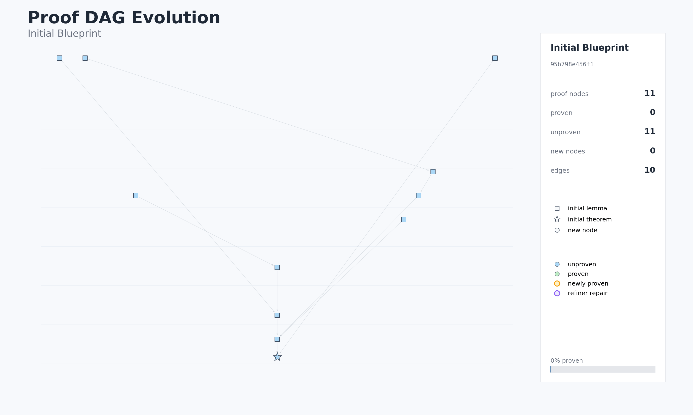

# Lean 4 Formalization of [Erdős #1196](https://arxiv.org/abs/2605.00301)

  

The repo is formalized by [LeanMarathon](https://github.com/YuanheZ/LeanMarathon).

## Inputs

- [source/problem.txt](source/problem.txt): theorem statement of Erdős #1196
- [source/paper/](source/paper/): LaTeX source of paper

## Output

- [LeanMarathon/Main.lean](LeanMarathon/Main.lean): completed Lean file

## Proof DAG Evolution

  

